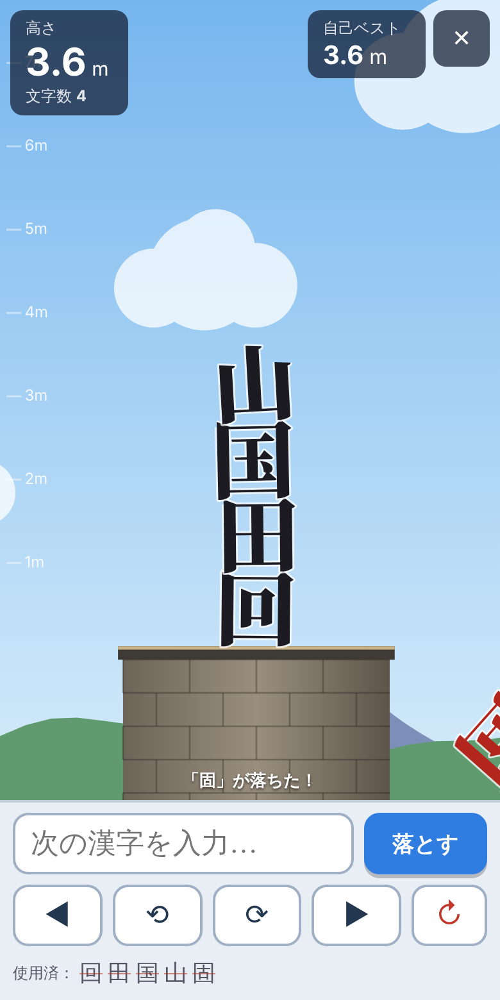

# 漢字タワー

**▶ プレイ：https://cadmium2525.github.io/kanji-tower/**

好きな漢字を1文字入力して落とし、**字形そのものの当たり判定**で積み上げていくブラウザゲームです（シングルモード）。

- 漢字はブロックではなく、フォントの輪郭（外周・穴・離れた画）どおりの剛体として落ちます。
- 「凹」のくぼみ、「田」「回」の穴、「川」のように離れた画も、見た目どおりに衝突します。
- 外部APIキー・有料サービス不要。静的ファイルだけで動くので、無料ホスティングで公開できます。



## 起動方法

Node.js 20 以上が必要です。

```bash
npm install
npm run dev        # 開発サーバー → 表示されたURL（http://localhost:5173/）をブラウザで開く
```

本番ビルドと確認:

```bash
npm run build      # 型チェック + dist/ に静的ファイルを出力
npm run preview    # dist/ をローカル配信（http://localhost:4173/）
```

GitHub Pages へは `.github/workflows/pages.yml` が push のたびに自動でビルド・テストし、`gh-pages` ブランチへ公開します（Pages の公開元は gh-pages ブランチ）。

`dist/` フォルダをそのまま GitHub Pages / Cloudflare Pages / Netlify などの**無料**静的ホスティングに置けば公開できます（相対パスで出力しているのでサブパスでも動きます）。

スマホ実機で試す場合は `npm run dev -- --host` で同じLANから `http://<PCのIP>:5173/` を開いてください。

## 操作

| 操作 | スマホ | PC |
| --- | --- | --- |
| 漢字の入力 | 入力欄に1文字（変換を確定） | 同左 |
| 左右移動 | ◀ ▶ 長押し / 画面を左右ドラッグ | ← → |
| 回転（15°刻み、長押しで連続） | ⟲ ⟳ | Q / E（入力欄の外で） |
| 落とす | 「落とす」 | Enter / Space |
| リトライ | ↻ / 「もう一度遊ぶ」 | R |

## 完成している機能

- **字形どおりの物理演算**：opentype.js で輪郭取得 → 曲線の適応サンプリング → Douglas-Peucker で簡略化 → 入れ子判定で外周/穴を分類 → earcut で穴付き三角形分割 → Hertel–Mehlhorn で凸多角形に統合 → Matter.js の**単一の複合剛体**として生成。四角形へのフォールバックはしません（形状を作れない字はエラー表示）。
- 質量はインク面積に比例（上下限あり）。密度・摩擦は全字共通。仕様書の初期値（friction .65 / frictionStatic .85 / restitution .05 / frictionAir .002 / 反復 8,8 / 60Hz固定）を使用。
- 極細の線（明朝体の横画など）は、薄い方向にだけ最小厚み 5 を保証（見た目とのずれは片側最大約2.5単位）。
- 1/60秒の固定タイムステップ（3サブステップ）＋速度上限で、深い食い込みによる「爆発」を抑制。
- 自由入力：NFC正規化、空白除去、書記素1つ・漢字のみ許可、異体字セレクタは拒否、IME変換中は確定しない、フォント欠字はエラー表示。
- プレビュー（半透明の字＋落下予告ガイド）、左右移動・回転・落下、安定判定（0.5秒静止）、接地しない場合は10秒でタイムアウト失敗。
- **同じ漢字は1プレイ1回まで**（落下確定時に消費。設定で解除可）。使用済み一覧を表示。
- ゲームオーバー：どの字でも台から落ちたら終了（落ちた字を赤く表示）。
- 高度（100単位＝1m）・文字数・自己ベスト（localStorage、リロード後も保持、保存失敗時も続行）。
- ゲームオーバー画面：最高高度、文字数、使用漢字、最高到達時のタワー画像、**1タップでもう一度**、PNG保存、Web Share API による共有（非対応環境は画像保存＋投稿文コピー）、X投稿（文章のみ）。
- カメラ追従、高度で空が昼→夕→夜に変化、高度目盛りと自己ベストライン。
- **BGM・効果音**：作曲アプリ「かなでる」（[cadmium2525/mp4mp3](https://github.com/cadmium2525/mp4mp3) の `daw/`）で制作。BGM は箏・笛・パッド・カリンバ・ベース・ローファイドラムの和風ループ（E マイナー・ペンタトニック、88BPM、24小節、継ぎ目なしループ）。効果音は着地（木の音、強さで軽/重を切り替え、毎回わずかに音程が変わる）、落下、安定、回転、ボタン、エラー、崩壊、自己ベスト更新、ゲームオーバーのジングル、開始。設定で BGM と効果音を別々にオン/オフ。タブを隠すと音も止まる。
- スマホ縦持ち優先レイアウト、タップ領域 44px 以上、動きを抑える設定。
- タブ非表示中は物理を止め、復帰時に時間を飛ばさない。画面サイズ変更・回転に追従。低性能端末では描画解像度を自動で下げる（物理の固定更新は維持）。

## 未完成・対象外

- **対戦モード**（ローカル2人／オンライン）：タイトルに「準備中」と表示。
- ランキング、オンライン記録。
- X への画像自動添付（仕様どおり保証しない。Web Share 対応端末では画像付き共有可）。
- 異体字セレクタ付きの入力（仕様どおり非対応として拒否）。

## 既知の問題・制限

- **フォント容量が約4MB**（Noto Serif JP Black の漢字 13,311 字サブセット）。初回は読み込みに数秒かかることがあります（進捗表示あり、以後はブラウザキャッシュ）。gzip/brotli 配信できるホストを推奨。
- 収録外の漢字（一部の拡張漢字・𠀋 など）は「フォントに収録されていません」と表示され、落とせません。
- 「凹」のくぼみは、このフォント（極太明朝）では幅が約9単位しかないため、入り込めるのは細い画の先端程度です（字形どおりの判定の結果です）。
- 明朝体の細い横画は最小厚み保証のため、当たり判定が見た目より最大約2.5単位太くなります。
- Matter.js の特性上、長時間置いた塔がわずかにずれる（クリープ）ことがあります。静止した字はスリープさせて抑えています。
- 30字以上が同時に激しく動くと、低性能スマホでは処理が重くなる可能性があります（本環境では最悪ケースで平均約4ms/フレーム）。
- 自動テストでは IME をイベントで模擬しています。実機の各IME（iOS / Android / Windows / macOS）での確認は未実施です。

## BGM・効果音の作り直し

音の元データは `audio-src/*.json`（「かなでる」の曲・効果音の形式）です。編集したら次で `public/audio/*.mp3` を作り直せます（Node.js と ffmpeg が必要）。

```bash
git clone https://github.com/cadmium2525/mp4mp3 ../mp4mp3
scripts/build-audio.sh ../mp4mp3
```

BGM は曲の長さ（65.45秒）で切り、はみ出た残響を曲の頭に重ねてあるので、ループの継ぎ目で音が途切れません。

## テスト

```bash
npm test           # ユニット・物理テスト（Vitest, Node上でフォントを実際に読み込んで検証）
npm run build && npm run test:e2e   # ブラウザ動作テスト（Playwright + Chromium、スクリーンショットを screenshots/ に保存）
```

最新の結果（2026-10-17）:

- `npm test`：**46 / 46 合格**
  - 入力検証（ひらがな・絵文字・複数文字・異体字セレクタの拒否、NFC正規化）
  - 代表21字（一二三人山川田口日木凹凸品森国回囲園図固龍）の凸分割・文字枠
  - 田の4つの穴、回の内外の空間、凹のくぼみ、川の離れた画が当たり判定に反映されること
  - 「一 山 人 田 凹 国 回 龍」の着地と安定、積み上げ、再使用禁止、落下・崩壊でのゲームオーバー、接地なしタイムアウト、性能
- `npm run test:e2e`：**22 / 22 合格**（BGM・効果音の読み込み、BGM の開始・停止・再開、入力拒否、欠字検知、凹への入り込み、積み上げ、ゲームオーバー、PNG保存、リトライボタン・1タップリトライ、リロード後の自己ベスト、キーボード操作、リサイズ・タブ復帰、コンソールエラーなし）

スクリーンショット: [docs/screenshots](docs/screenshots)

## 構成

```
index.html          画面（タイトル / プレイ / ゲームオーバー / 遊び方 / 設定）
src/geometry.ts     輪郭 → リング → 穴付き三角形分割 → 凸パーツ（純粋関数）
src/glyph.ts        フォント読み込み・字形キャッシュ
src/physics.ts      Matter.js の世界、複合剛体生成、固定ステップ
src/core.ts         シングルモードの進行（DOM非依存・テスト可能）
src/render.ts       Canvas 2D 描画
src/main.ts         UI・入力・カメラ・ループ
src/result.ts       結果画像PNG・共有
src/audio.ts        BGM・効果音の再生
audio-src/          BGM・効果音の元データ（かなでる形式の JSON）
public/audio/       書き出した MP3
src/storage.ts      自己ベスト・設定の保存
tests/              Vitest
scripts/e2e.mjs     Playwright によるブラウザテスト
```

技術：Vite / TypeScript / Matter.js / opentype.js / earcut / Canvas 2D（すべてMIT等の無償OSS）。

## ライセンス

- フォント：[Noto Serif JP](https://github.com/notofonts/noto-cjk)（Black、漢字のみサブセット化）— SIL Open Font License 1.1。全文は `public/fonts/OFL.txt`。OFL に基づき再配布・同梱が可能です（フォント単体の販売は不可）。
- ライブラリ：matter-js (MIT)、opentype.js (MIT)、earcut (ISC)。
